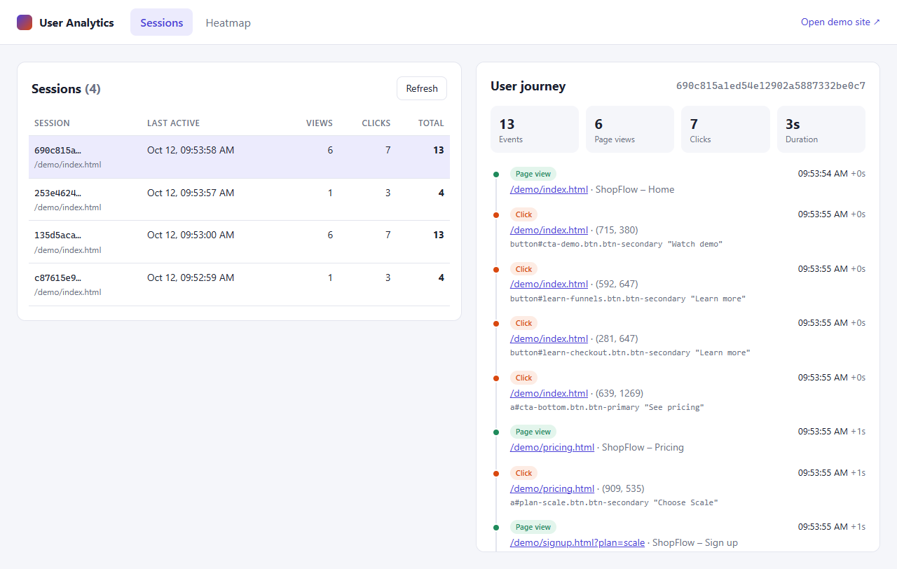
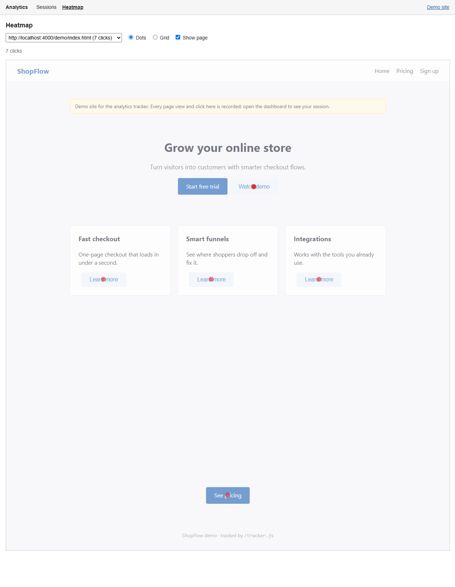
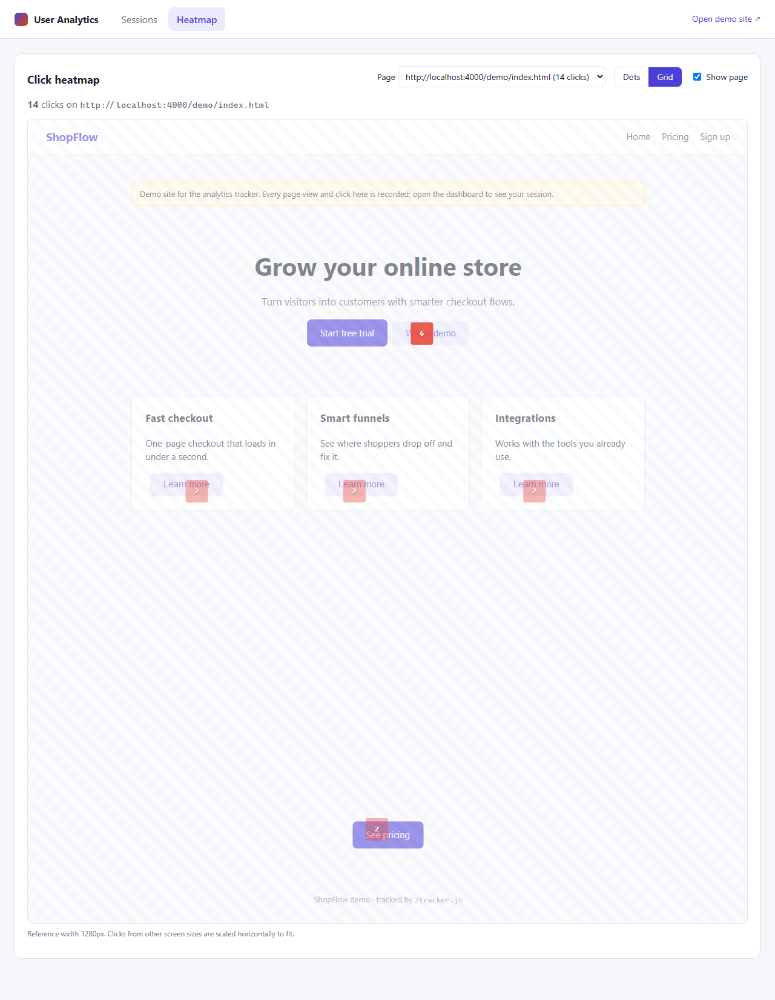

# User Analytics

A small analytics app. A tracking script records page views and clicks on any website, a Node.js API stores them in MongoDB, and a React dashboard shows each session's journey and a click heatmap for each page.

**Live demo:** click around the [demo site](https://causalfunnel-analytics-n0mw.onrender.com/demo/index.html), then open the [dashboard](https://causalfunnel-analytics-n0mw.onrender.com) to see your session and the heatmap. It runs on Render's free tier, so the first load after a quiet spell can take about a minute.



| Heatmap (dots) | Heatmap (grid) |
| --- | --- |
|  |  |

## Tech stack

| Part | Tech |
| --- | --- |
| Tracker | Plain JavaScript, no dependencies (~1.7 KB minified + gzipped) |
| Backend | Node.js, Express, Mongoose |
| Database | MongoDB 7 |
| Dashboard | React 19 + Vite |
| Tests | `node:test` + supertest (API), puppeteer-core (end-to-end in a real browser) |
| Run | Docker Compose, or Node + a local MongoDB |

## Quick start (Docker)

```bash
docker compose up --build
```

Then open:

- **Demo site:** http://localhost:4000/demo/index.html (click around here)
- **Dashboard:** http://localhost:4000

The API serves the dashboard, the tracker script and the demo site, so it all runs on one port.

## Deploy (free)

The app is one Docker service plus MongoDB, so it runs on free tiers:

1. Create a free MongoDB Atlas M0 cluster. Add a database user, allow access from `0.0.0.0/0`, and copy the connection string. Add a database name to it, for example `.../causalfunnel_analytics?retryWrites=true&w=majority`.
2. On Render, choose **New > Blueprint**, select this repository and paste the connection string as `MONGODB_URI`. `render.yaml` sets up a free Docker web service with `/health` as its health check.

Render's free services sleep after 15 minutes without traffic, so the first request after that takes about a minute.

## Local development (without Docker for the app)

Requirements: Node 18+ and MongoDB on `localhost:27017`. To run only MongoDB in Docker: `docker run -d -p 27017:27017 mongo:7.0`.

```bash
# 1. API (http://localhost:4000)
cd backend
cp .env.example .env
npm install
npm run dev

# 2. Dashboard with hot reload (http://localhost:5173, proxies /api to :4000)
cd dashboard
npm install
npm run dev
```

## Adding the tracker to any website

```html
<script src="http://localhost:4000/tracker.js" async></script>
```

The script sends events to the server it was loaded from. To send them somewhere else, add `data-endpoint="https://your-api.example.com"`. Add `data-debug="true"` to log every event to the console.

### What it records

| Field | Notes |
| --- | --- |
| `sessionId` | Random id stored in `localStorage`, with a cookie as fallback. A new session starts after 30 minutes of inactivity. |
| `type` | `page_view` or `click` |
| `url` / `pageUrl` | Full URL, plus a normalized `origin + path` that groups pages for the heatmap |
| `timestamp` | Client time (ISO 8601). The server falls back to its own time if the client value is implausible. |
| `x`, `y` (clicks) | `pageX` / `pageY`, so they are document coordinates and stay correct after scrolling |
| `target` (clicks) | Short description of the clicked element, e.g. `button#cta-demo "Watch demo"` |
| `viewportWidth/Height`, `pageWidth/Height` | Used to place clicks from different screen sizes on one heatmap |

### How events are sent

- Events are queued and sent in batches every 2 seconds, or as soon as 20 are queued.
- When the tab is hidden or closed, the queue is sent with `navigator.sendBeacon`, so the last clicks before leaving a page are not lost.
- Requests use `Content-Type: text/plain`. This keeps them "simple" CORS requests, so there is no preflight round trip on third-party sites.
- Single-page apps are supported: `history.pushState`, `replaceState` and `popstate` count as page views.

## API

| Method | Endpoint | Description |
| --- | --- | --- |
| `POST` | `/api/events` | Ingest events. Body: one event, an array, or `{ "events": [...] }` (max 100). Valid events are stored and invalid ones are listed in `rejected`. |
| `GET` | `/api/sessions?page=1&limit=20` | Sessions with event counts (`eventCount`, `pageViews`, `clicks`), most recently active first |
| `GET` | `/api/sessions/:sessionId/events` | All events of one session in time order (the user journey) |
| `GET` | `/api/heatmap?pageUrl=<url>` | Click coordinates for one page. The query string in `pageUrl` is ignored, so `/pricing?ref=x` matches `/pricing`. |
| `GET` | `/api/pages` | Tracked pages with view and click counts (fills the heatmap page picker) |
| `GET` | `/health` | Returns 200 when MongoDB is connected |

Example:

```bash
curl -X POST http://localhost:4000/api/events -H "Content-Type: application/json" -d '{
  "sessionId": "test-session-123",
  "type": "click",
  "url": "https://example.com/pricing",
  "timestamp": "2026-10-12T10:00:00Z",
  "x": 420, "y": 610
}'
```

## Data model

**`events`**: one document per event.

- Index `{ sessionId: 1, timestamp: 1 }` serves the journey query.
- Index `{ pageUrl: 1, type: 1 }` serves the heatmap query.

**`sessions`**: one document per session (`_id` = session id), holding `firstSeen`, `lastSeen`, `eventCount`, `pageViews`, `clicks` and `entryPage`. It is updated on every ingest with one `bulkWrite` of `$inc` / `$min` / `$max` upserts.

Keeping a separate sessions collection makes the sessions list a cheap indexed, paginated read (index on `lastSeen`). The alternative, a `$group` over every event on each dashboard load, gets slower as the events collection grows.

## Dashboard

- **Sessions:** a paginated list of sessions with view, click and total counts. Selecting one shows the journey: a timeline of every page view and click, with relative time, the clicked element and its coordinates.
- **Heatmap:** pick a page to see its clicks, either as **dots** or as a **grid** of 40px cells showing click counts. With **Show page** on, the real page is drawn underneath so you can see what was clicked.
- The URL keeps the current view (e.g. `#/sessions/<id>` or `#/heatmap?page=...`), so links can be shared and the back button works.
- Works on mobile.

## Tests

```bash
# API integration tests (needs MongoDB on localhost:27017; uses and drops a throwaway database)
cd backend && npm test

# End-to-end: two simulated visitors click through the demo site in headless Chrome.
# The run checks the API data and the dashboard, then saves screenshots to e2e/screenshots/
cd e2e && npm install && npm test
# options: BASE=http://localhost:4000 BROWSER="/path/to/chrome"
```

The API tests (15) cover:

- ingest: batches, `text/plain` bodies, partial rejection, invalid JSON, batch size limit, timestamp clamping, session roll-ups across requests
- the read endpoints: ordering, pagination, 404s, heatmap URL normalization
- serving the static files

The end-to-end run checks:

- separate session ids for separate visitors
- the session id persists across page loads
- counts and event order in the API
- document-coordinate clicks after scrolling
- one heatmap dot per click
- viewing a heatmap does not record extra page views
- no horizontal scroll on mobile
- no console errors

## Assumptions and trade-offs

- **Sessions are client-defined:** a random id per browser, renewed after 30 minutes of inactivity (the same rule Google Analytics uses). There are no user accounts or cross-device identity.
- **The heatmap uses one reference width.** Clicks are stored in document pixels along with the page width at click time. The heatmap uses the most common page width and scales each click's `x` to it, while `y` is kept as-is. This is exact for fixed-width layouts and close for responsive ones. A production version would group by screen-size bucket or record element-relative positions.
- **The page preview is a live iframe**, not a screenshot. The tracker skips frames named `cf-heatmap-preview`, so viewing a heatmap never records page views. Sites that send `X-Frame-Options: DENY` will show dots without the page behind them.
- **Ingest is open (CORS `*`, no API key)** because the tracker runs on arbitrary sites. Input is validated and bounded: allowed schemes only, string length caps, 100 events per request, 256 KB body limit, plausible timestamps. A real deployment would add per-site keys, rate limiting and bot filtering.
- **The dashboard has no authentication.** It's out of scope for the assignment, but would be needed before exposing it publicly.
- **Writes are not transactional across the two collections.** If the session upsert failed after the events were inserted, the counts could lag behind the events. At this scale that's an acceptable trade for simplicity; a background job could re-derive the counts from `events`.
- **No data retention policy.** A TTL index on `events.timestamp` would be the simple way to add one.

## Project structure

```
backend/        Express API (src/), demo website (public/demo), API tests (test/)
dashboard/      React + Vite dashboard
tracker/        tracker.js, the embeddable script (served at /tracker.js)
e2e/            Browser end-to-end check (puppeteer-core)
docs/           Screenshots
Dockerfile      Builds the dashboard and runs the API, which serves everything
docker-compose.yml
```
